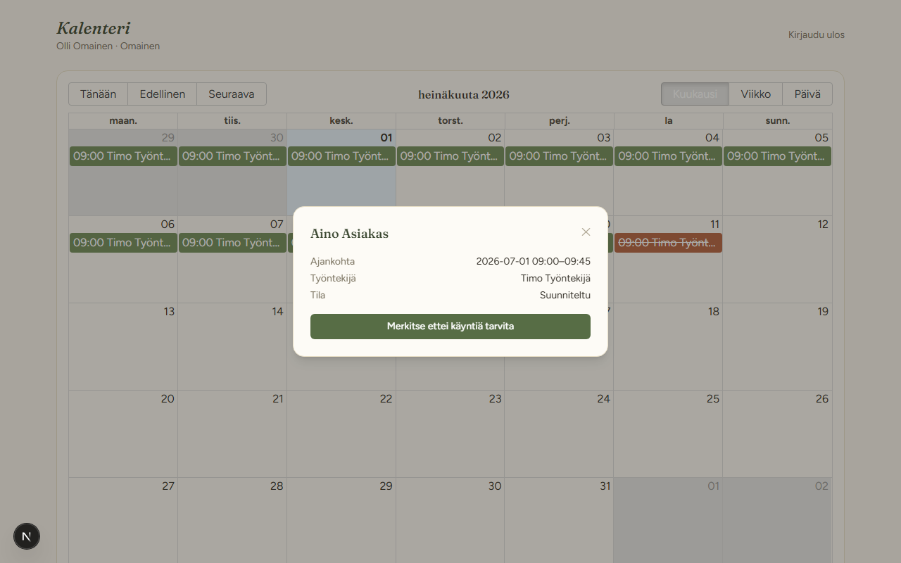
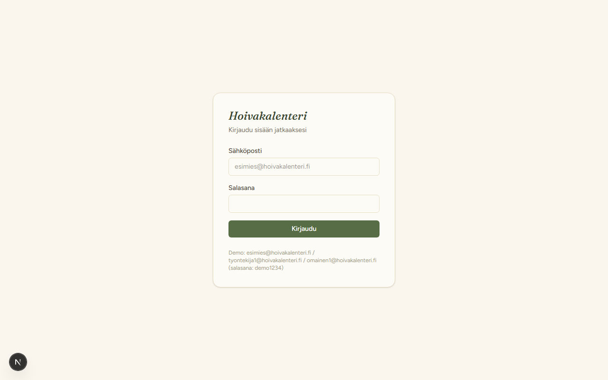
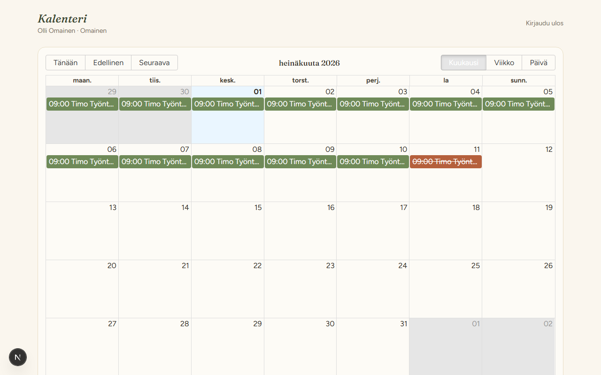
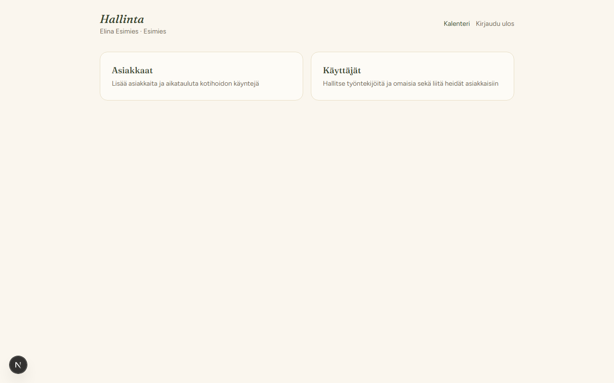

# Hoivakalenteri

Kotihoidon käyntikalenteri, joka yhdistää tiedonkulun omaisten, työntekijöiden ja esimiesten
välillä. Kun asiakkaan omainen tietää hakevansa asiakkaan kotoa tiettynä päivänä, hän merkitsee
sen kalenteriin — ja tieto siitä, ettei käyntiä tarvita, näkyy heti sekä käynnistä vastaavalle
työntekijälle että esimiehelle.

Rakennettu portfolioprojektiksi, joka yhdistää sote-alan käytännön kokemuksen (työskentelen
Lähihoitajana kotihoidossa) ja full stack -osaamisen.



## Ydintoiminnallisuus

1. **Omainen** merkitsee kalenterista käynnin, jota ei tarvita ("haen asiakkaan itse", "asiakas
   sairaalassa", tms.)
2. Käynti näkyy välittömästi **peruttuna** sekä käynnistä vastaavan **työntekijän** että
   **esihenkilön** kalenterissa — kukaan ei tee turhaa kotikäyntiä.
3. **Esihenkilö** hallinnoi asiakkaita, käyttäjiä (työntekijät/omaiset) ja heidän liitoksiaan
   asiakkaisiin, sekä aikatauluttaa käynnit.

| Rooli | Näkee kalenterissa | Voi tehdä |
|---|---|---|
| Omainen | Vain oman/liitettyjen asiakkaiden käynnit | Merkitä/peruuttaa poikkeuksen omille asiakkailleen |
| Työntekijä | Vain omat aikataulutetut käynnit | Ei voi merkitä poikkeuksia (vain vastaanottaa tiedon) |
| Esihenkilö | Kaikki käynnit | Hallinnoi asiakkaita, käyttäjiä, liitoksia ja käyntejä; voi merkitä poikkeuksen omaisen puolesta |

## Arkkitehtuuri

```
frontend/  Next.js 16 (App Router, TypeScript, Tailwind v4)
           react-big-calendar kalenterinäkymä, axios + JWT localStorage-autentikointi
backend/   FastAPI + SQLAlchemy + PostgreSQL
           Roolipohjainen pääsynhallinta jokaisessa reitissä (ei vain UI-tasolla)
```

Backendin roolipohjainen rajaus on projektin ydinkohta: jokainen `/kaynnit/`- ja
`/poikkeukset/`-kutsu suodattaa tulokset käyttäjän roolin ja `AsiakasLinkki`-liitosten mukaan
(`get_accessible_asiakas_ids` backend/app/auth.py:ssä), eikä luota koskaan pelkkään
frontend-tason roolintarkistukseen.

## Paikallinen kehitysympäristö

```bash
# 1. Käynnistä Postgres
docker compose up -d

# 2. Backend
cd backend
python -m venv venv
./venv/Scripts/activate        # Windows
pip install -r requirements.txt
cp .env.example .env           # muokkaa tarvittaessa
python -m app.seed             # luo demokäyttäjät ja -asiakkaat
uvicorn app.main:app --reload

# 3. Frontend (uudessa terminaalissa)
cd frontend
cp .env.local.example .env.local
npm install
npm run dev
```

Sovellus on osoitteessa http://localhost:3000, API dokumentaatio (Swagger) osoitteessa
http://localhost:8000/docs.

### Demokäyttäjät (salasana kaikille: `demo1234`)

- `esimies@hoivakalenteri.fi` — esihenkilö
- `tyontekija1@hoivakalenteri.fi` / `tyontekija2@hoivakalenteri.fi` — työntekijät
- `omainen1@hoivakalenteri.fi` / `omainen2@hoivakalenteri.fi` — omaiset

## Kuvakaappaukset

| Kirjautuminen | Omaisen kalenteri | Esimiehen hallinta |
|---|---|---|
|  |  |  |

## Tunnetut yksinkertaistukset (MVP-rajaukset)

Nämä ovat tietoisia rajauksia portfolio-MVP:tä varten, ei unohduksia:

- **Ei migraatiotyökalua (Alembic).** Taulut luodaan `Base.metadata.create_all`-kutsulla
  käynnistyksessä. Toimii MVP:ssä, mutta seuraava oikea muutos skeemaan vaatisi Alembicin.
- **JWT localStorageissa**, ei httpOnly-evästeissä. Yksinkertaisempi toteuttaa, mutta
  tuotannossa evästeet olisivat XSS-kestävämpi valinta.
- **Ei toistuvien käyntien moottoria** (RRULE). Jokainen käynti on oma rivi — toistuvien
  käyntien luonti on esimiehen UI:n/seed-skriptin vastuulla, ei skeeman ominaisuus.
- **Ei ilmoituksia** (esim. push/sähköposti kun poikkeus merkitään). Tieto näkyy kalenterissa
  seuraavan kerran kun käyttäjä avaa sen.
- **Ei itserekisteröitymistä.** Tarkoituksellinen valinta — oikeassa kotihoito-organisaatiossa
  tilit luo esimies, ei työntekijä/omainen itse.
- **CORS on rajattu** yhteen frontend-originiin (toisin kuin avoimempi esimerkkiprojektini
  talousanalyysi) — henkilötietoja käsittelevässä sovelluksessa tiukempi CORS on oikea valinta
  jo MVP-vaiheessa.

## Julkaisu

- **Backend + Postgres:** Railway (`backend/Procfile` + `backend/nixpacks.toml` valmiina).
  Aseta `SECRET_KEY` ja `FRONTEND_ORIGIN` Railwayn ympäristömuuttujiksi, aja `seed.py` kertaalleen
  ensimmäisen julkaisun jälkeen.
- **Frontend:** Vercel, `NEXT_PUBLIC_API_URL` osoittamaan Railway-backendiin.
